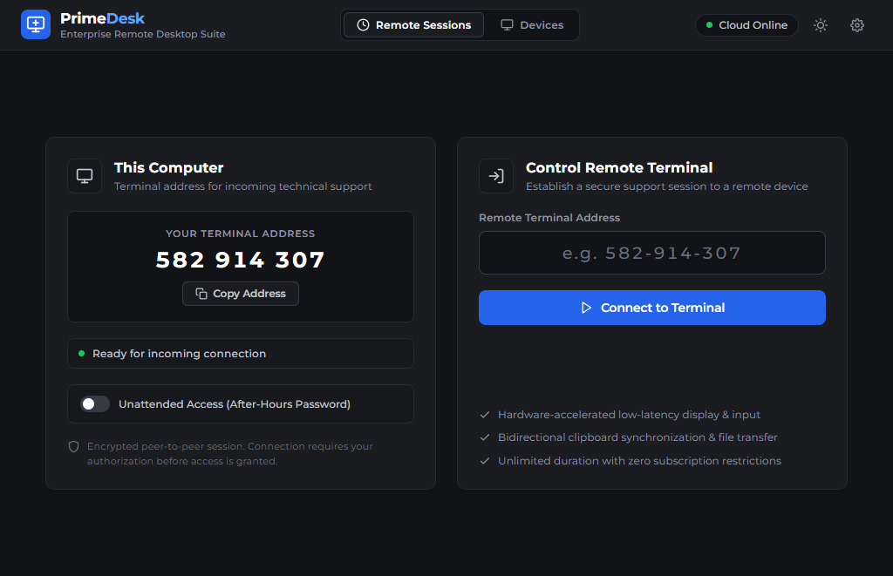
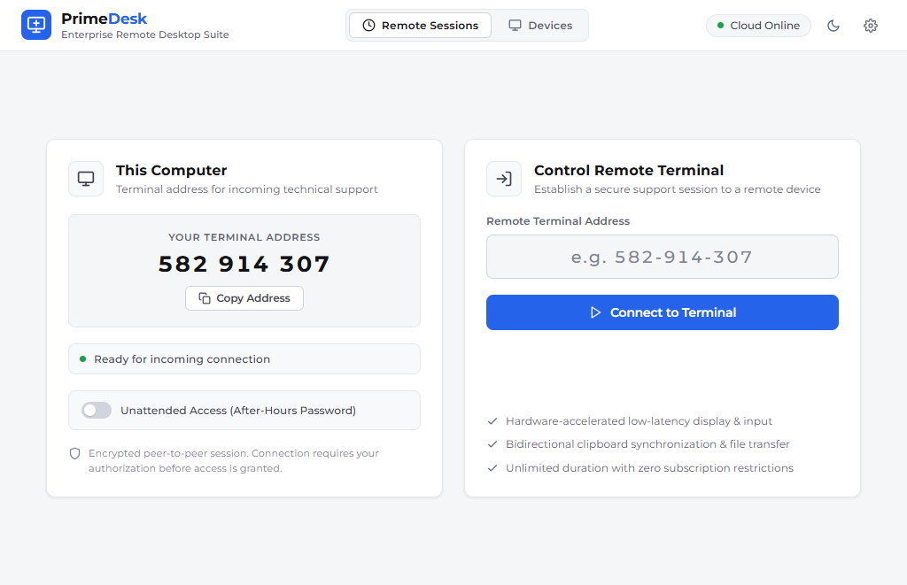
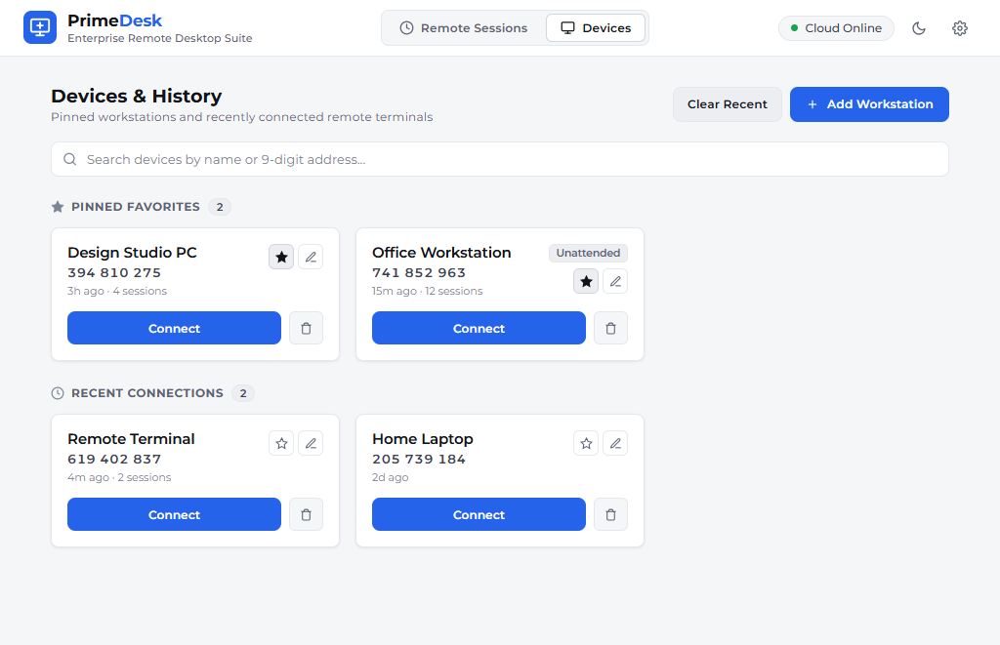
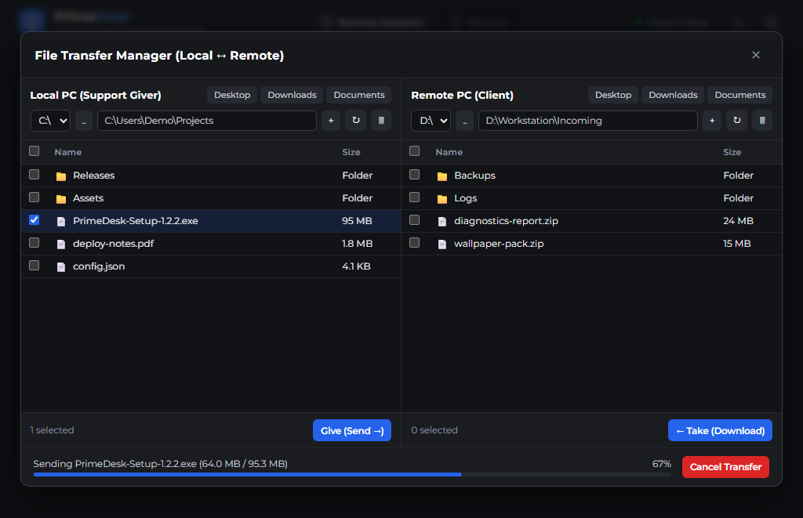
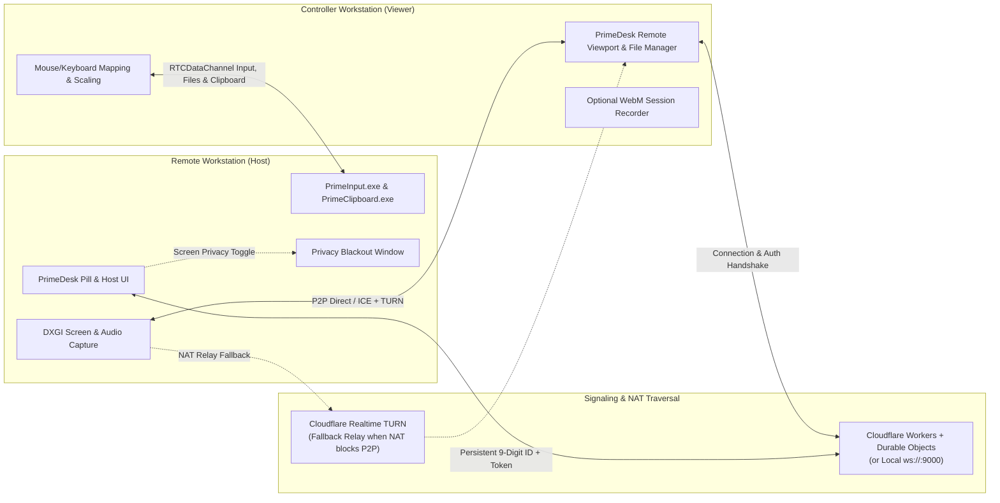

# PrimeDesk

> **Fast, Lightweight Open-Source Alternative to AnyDesk & TeamViewer**  
> *P2P WebRTC Remote Desktop • Sub-Millisecond Native Input • Zero Subscriptions or Time Limits*

[](https://github.com/basliel26/PrimeDesk/actions/workflows/build.yml)
[](https://github.com/basliel26/PrimeDesk/releases)
[](https://opensource.org/licenses/MIT)

---

## ⚡ Overview

**PrimeDesk** is an open-source, peer-to-peer remote desktop application built for **speed, simplicity, and zero paywalls**. Engineered as a fast alternative to commercial tools like AnyDesk and TeamViewer, PrimeDesk pairs hardware-accelerated WebRTC video (up to 60 FPS) with native Windows C# input and clipboard helpers — giving you responsive remote control without licensing fees, commercial session timers, or forced accounts.

It works out of the box across continents over the internet (via **Cloudflare Workers + Durable Objects** signaling and **Cloudflare Realtime TURN** relay for strict firewalls) as well as **100% offline** on local Wi-Fi / LAN networks.

---

## 🖥️ Screenshots

<table>
  <tr>
    <td width="50%">
      <strong>Dashboard — Dark Mode</strong><br />
      
    </td>
    <td width="50%">
      <strong>Dashboard — Light Mode</strong><br />
      
    </td>
  </tr>
  <tr>
    <td width="50%">
      <strong>Devices &amp; Session History (Pinned + Recent)</strong><br />
      
    </td>
    <td width="50%">
      <strong>Dual-Pane File Transfer Manager</strong><br />
      
    </td>
  </tr>
</table>

---

## 🚀 Download Windows Binaries (Windows 10 / 11 / Server)

Pre-compiled standalone Windows x64 binaries are built and published automatically on GitHub Releases:

📦 **[Download Latest PrimeDesk Release](https://github.com/basliel26/PrimeDesk/releases/latest)**

- **`PrimeDesk-Setup-1.2.3.exe`** — Standard Windows installer with desktop shortcut, start menu entry, and optional startup launch.
- **`PrimeDesk-Portable-1.2.3.exe`** — Single self-contained executable that runs directly from any folder or USB drive with zero installation (with persistent terminal IDs via `%APPDATA%\PrimeDesk`).

---

## ✨ Key Features

| Area | Capability | Details |
| :--- | :--- | :--- |
| **Speed & Responsiveness** | **Hardware Capture + Native C# Input** | DirectX DXGI desktop capture (15 / 30 / 60 FPS profiles) paired with `PrimeInput.exe` calling Win32 `SendInput` for ultra-low-latency cursor and keyboard control. |
| **Instant Connection** | **Persistent 9-Digit Terminal IDs** | Each workstation keeps a persistent 9-digit address (`XXX XXX XXX`) with device-token identity protection and an instant **Accept / Decline** prompt for interactive sessions. |
| **Unattended Access** | **After-Hours Master Password** | Optional salted SHA-256 master password unlocks direct unattended login without someone sitting at the remote keyboard. |
| **Devices & History** | **Pinned Favorites + Recent History** | Automatically keeps your last **15** connected destinations for quick one-click reconnect, with **Pin/Bookmark**, search filter, custom nicknames, and clear-history controls. |
| **File Transfers** | **Dual-Pane File Manager & `CF_HDROP`** | Stream unlimited files and folders both directions (`Give` & `Take`) over chunked WebRTC data channels, or copy & paste files directly with right-click Copy/Paste or `Ctrl+C` / `Ctrl+V` via `PrimeClipboard.exe`. |
| **Global Connectivity** | **P2P + Cloudflare TURN + Offline LAN** | Connects direct peer-to-peer whenever possible, falls back seamlessly to Cloudflare Realtime TURN across restrictive NAT/firewalls, and supports isolated LAN mode + HTTP/SOCKS5 proxies. |
| **Host Controls** | **Floating Pill & Privacy Blackout** | Hosting minimizes into a compact always-on-top session pill with live chat & instant disconnect; remote technicians can also toggle Privacy Mode screen blackout and special keys (`Ctrl+Shift+Esc`, `Win+D`, `Win+L`). |
| **Modern Minimal UI** | **Responsive Dark / Light / System UI** | Offline bundled **Montserrat** typography, Dark / Light / Match System themes, and fluid layout scaling from compact `360px` windows up to maximized desktops. |
| **Audit & Safety** | **DTLS/SRTP + Recording + Auto-Lock** | End-to-end encrypted WebRTC media/data channels, optional local `.webm` session recording, audit logs, and optional Windows auto-lock (`Win+L`) on disconnect. |

---

## 🏗️ Architecture



---

## ⚙️ Preferences Overview

Open **Preferences** from the top-right gear icon (or switch Light/Dark instantly with the Sun/Moon toggle):

1. **General & System**: Color Theme (**Dark**, **Light**, **Match System**), Windows startup toggle, minimize-to-tray behavior, sleep prevention.
2. **Network & Proxy**: Cloud Global mode vs. Local Offline LAN mode, custom STUN configuration, HTTP/SOCKS5 proxy rules.
3. **Display & Quality**: Framerate target (`60`, `30`, `15` FPS), bandwidth profile (`Ultra`, `Balanced`, `Low`), hardware capture toggle.
4. **Audio & Media**: Remote system audio streaming, automatic host speaker muting during sessions.
5. **Security & Access**: Unattended password management, permission toggles (input, clipboard, file transfer, privacy mode), optional auto-lock on disconnect.
6. **Recording & Audit**: Auto-record sessions to `.webm`, custom save folder picker, local audit trail.

---

## ☁️ Self-Hosting Signaling (Cloudflare Workers or Local LAN)

PrimeDesk connects to its hosted Cloudflare Worker signaling cluster out of the box, or you can deploy your own in under a minute:

### Option A: Cloudflare Workers + Durable Objects ([`cloudflare-signaling/`](cloudflare-signaling/))
```bash
cd cloudflare-signaling
npm install
npx wrangler secret put TURN_API_TOKEN   # Optional: enables Cloudflare Realtime TURN credentials
npx wrangler deploy
```

### Option B: Local / Offline LAN Server ([`src/server/signaling.js`](src/server/signaling.js))
```bash
npm install
npm run server
```
Then select **Offline / Local Network** under **Preferences ➔ Network & Proxy** in PrimeDesk.

---

## 💻 Local Development & Building

### Prerequisites
- [Node.js](https://nodejs.org/) (v20 recommended)
- Windows 10 / 11 / Server (x64)

### Run from Source
```bash
git clone https://github.com/basliel26/PrimeDesk.git
cd PrimeDesk
npm install
npm start
```

### Build Windows Installer & Portable `.exe`
```bash
npm run build:win
```
Generated executables are written to the `dist/` folder (`PrimeDesk-Setup-<version>.exe` and `PrimeDesk-Portable-<version>.exe`).

---

## 👤 Author & License

- **Author:** Basliel Getu ([@basliel26](https://github.com/basliel26))
- **Repository:** [github.com/basliel26/PrimeDesk](https://github.com/basliel26/PrimeDesk)
- **License:** [MIT License](https://opensource.org/licenses/MIT) — free for personal and commercial use.
